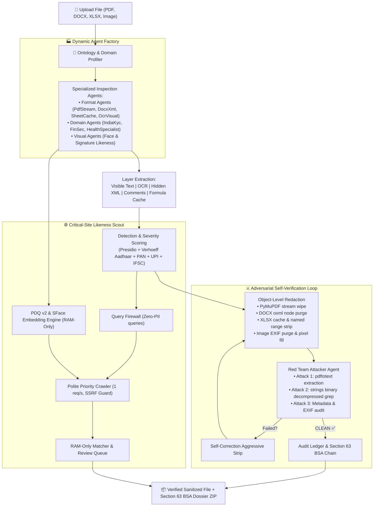

# 🛡️ SHIELD·SCOUT
### Dynamic Agentic Privacy Defense, True Object-Level Redaction & Critical-Site Likeness Radar
> **Vyuham'26 Challenge: AF-13 — Privacy Leakage Detection, Secure Redaction & Leak Discovery**  
> *Secure Object-Level Redaction & On-Device Likeness Radar*

---

## 📌 Problem Context & Executive Summary

Modern document exchanges (PDFs, spreadsheets, presentations, and screenshots) suffer from a fatal flaw: **visual redaction (drawing a black box) leaves the underlying data completely recoverable in document streams, XML trees, formula caches, and EXIF metadata.** Furthermore, once sensitive documents leak, victims have no way of knowing where their personal details, signatures, or photos have surfaced across the web.

**SHIELD·SCOUT** solves this end-to-end with an on-device privacy defense engine:
1. **Dynamic Situation-Aware Agent Swarms:** An ontology profiler inspects document format, domain, and layers, auto-spawning specialized inspector and attacker agents tailored on the fly.
2. **True Object-Level Redaction:** Wipes PDF text streams, annotations, XMP metadata, DOCX run splits, XML comment nodes, XLSX formula caches, hidden sheets, and image EXIF metadata.
3. **Adversarial Self-Verification:** An internal "Red Team" attacks its own output (text extraction, binary grep over decompressed streams, metadata auditing) before releasing sanitized files.
4. **On-Device Likeness Radar:** Consented 128-byte face vectors (YuNet + SFace) and 256-bit dihedral PDQ hashes search critical leak sites entirely in RAM — zero raw biometric or image data ever leaves the local machine.
5. **Section 63 BSA Tamper-Proof Audit Ledger:** Every transformation is immutably logged into a SHA-256 recursive hash chain for legal admissibility.
6. **Shield·Code CLI:** In-repo scanner for developers preventing accidental commits of secrets, Indian PII, and sensitive media with safe, undoable automated fixes.

---

## 🏗️ System Architecture



---

## ⚡ Tech Stack

| Layer | Technologies |
|---|---|
| **Core Runtime** | Python 3.11 |
| **Interactive Dashboard** | Streamlit 1.56 |
| **PII & Privacy Engine** | Microsoft Presidio Analyzer, spaCy (`en_core_web_sm`), Verhoeff checksum algorithm |
| **Document Redaction** | PyMuPDF (PDF), python-docx + lxml (DOCX), openpyxl (XLSX), Pillow + pytesseract (Images) |
| **Face & Biometric Radar** | OpenCV 4.10 (`FaceDetectorYN` YuNet + `FaceRecognizerSF` SFace 128-d quantized to INT8) |
| **Perceptual Fingerprinting** | Meta PDQ dihedral 256-bit hash with multi-region cropping |
| **Network & Crawlers** | HTTPX, BeautifulSoup4, Playwright (Chromium headless) with SSRF Guard |
| **Forensic Ledger** | SHA-256 recursive cryptographic hash chain |

---

## 🚀 Quickstart & Setup

### 1. Prerequisites
- Python 3.11+
- System packages: `tesseract-ocr`, `poppler-utils` (`pdftotext`)

### 2. Installation
```bash
git clone https://github.com/AleenaAntony19/CARTEL_VYUHAM26.git
cd CARTEL_VYUHAM26

# Create and activate virtual environment
python3 -m venv .venv
source .venv/bin/activate

# Install dependencies
pip install -r requirements.txt

# Download lightweight OpenCV Zoo ONNX models (~37 MB)
bash scripts/get_models.sh
```

### 3. Generate Demo Fixtures & Start Mock Leak Web
```bash
# Generate synthetic test files & mock leak web
python demo/make_fixtures.py demo/out
python demo/make_mockweb.py

# Start local polite mock leak web server
python demo/serve.py &
```

### 4. Run the Streamlit App
```bash
SHIELD_ALLOW_LOCAL=1 streamlit run app.py
```

---

## 🧪 Automated Testing & Validation

Run the complete test suite:
```bash
bash scripts/validate.sh
```
This runs:
- `pytest -q`: 15 unit and integration tests (Verhoeff checksums, Presidio Indian patterns, all redactor formats, adversarial red team, face/PDQ gates).
- Shield·Code CLI security scan over the codebase.
- Autonomous crawl against the mock leak web with live likeness and PDQ matching in RAM.
- Cryptographic verification of the SHA-256 ledger integrity.

---

## 🔒 Safety & Privacy Invariants

- **Originals are Never Modified**: Redactions are always produced as separate sanitized files.
- **Zero Raw PII / Biometrics on Disk**: Crawled images live only in volatile RAM; only a 128px radius-25 Gaussian-blurred thumbnail survives a confirmed match.
- **SSRF & Private Network Guard**: Fetcher strictly refuses loopback and private IP addresses (unless local demo flag is explicitly enabled).
- **Consented Likeness Enrolment**: Face radar requires live selfie confirmation matching the user's uploaded portrait + explicit consent.
