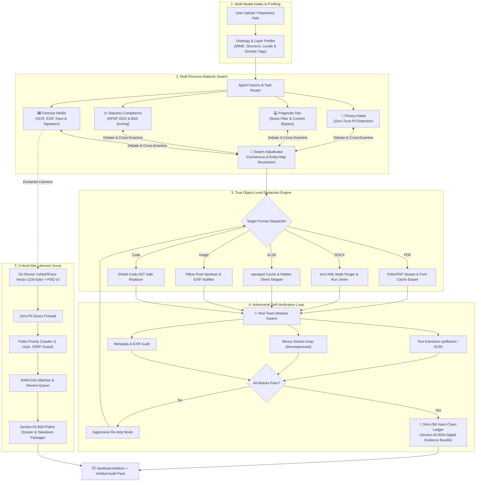

# 🏛️ SHIELD·SCOUT System Architecture

> **Vyuham'26 — Challenge AF-13: Privacy Leakage Detection, Secure Redaction & Leak Discovery**  
> *Architecture Paradigm: Multi-Persona Dialectic Swarm + True Object-Level Redaction + On-Device Likeness Radar*

---

## 1. Architectural Overview & Philosophy

Modern privacy leaks happen because traditional tools rely on **single-layer visual obfuscation** (drawing black boxes on top of text or images) while leaving underlying document streams, XML node trees, formula evaluation caches, and EXIF metadata intact. Furthermore, conventional security scanners rely on monolithic, rigid scripts that either generate overwhelming false positives or miss fragmented personal identifiers spread across multiple document layers.

**SHIELD·SCOUT** is built upon five foundational architectural pillars:
1. **Multi-Persona Dialectic Swarm:** Rather than trusting a single LLM or regex engine, multiple specialized agents with competing mindsets (*Privacy Hawk, Pragmatic Developer, Statutory Auditor, Adversarial Red-Teamer*) debate and reach consensus on ambiguous PII and severity.
2. **True Object-Level Redaction:** Destroys underlying PDF content streams, XML nodes (`w:del`, `w:comment`), spreadsheet formula `<v>` caches, and image pixels.
3. **Adversarial Self-Verification:** An internal "Red Team" attacks the output using independent forensic methods before releasing the file to the user.
4. **On-Device Likeness Radar:** Converts face portraits and signatures into 128-byte int8 vectors (YuNet + SFace) and 256-bit dihedral PDQ hashes. Performs likeness crawls against critical sites entirely in RAM—zero raw images or vectors leave the local machine.
5. **Cryptographic Section 63 BSA Hash Chain:** Immutably logs every transformation, debate verdict, and crawl event into a SHA-256 recursive ledger for legal admissibility.

---

## 2. Global System Topology

---

## 3. Subsystem Breakdown

### 3.1 Document Shield Subsystem
The Document Shield operates as an autonomous multi-stage pipeline:
1. **Structural Profiling:** Analyzes container internals (ZIP structures for OOXML, FlateDecode streams for PDF, EXIF headers for images).
2. **Layer Separation:** Dissects visible text, hidden comments, revision markers (`w:ins`/`w:del`), formula caches (`<v>`), metadata headers (`core.xml`, `app.xml`, `custom.xml`), and embedded raster images.
3. **Multi-Persona Detection:** Parallel agents extract candidate PII and run cross-layer linkability algorithms.
4. **Physical Object Destruction:**
   - **PDF:** Searches all spacing variants (`2345 6789 0124` vs `234567890124`), adds redaction annotations, and invokes `apply_redactions(images=PDF_REDACT_IMAGE_PIXELS)`. Destroys metadata, XML metadata packets, font caches, and embedded files.
   - **DOCX:** Operates directly on the ZIP/lxml XML tree. Unwraps insertions, drops tracked deletions, joins split runs (`w:r`) at the paragraph level, strips author identities, and unlinks `custom.xml`.
   - **XLSX:** Scrubs formula evaluation caches, comments, defined name ranges, pivot caches, and `veryHidden` sheets.
   - **Images:** OCR word box matching with black pixel fill, stripping 100% of EXIF, IPTC, and XMP headers.

### 3.2 Adversarial Self-Verification Subsystem (Red Team)
Before any sanitized document is delivered to the user or recorded on the ledger, the **Red-Team Attacker Swarm** launches three independent attacks:
1. **Attack 1 (Text Surface Extraction):** Invokes external `pdftotext -layout` and OCR engines on the sanitized file. If any original PII variant or high-confidence regex target is found, the attack fails.
2. **Attack 2 (Decompressed Binary Stream Grep):** Decompresses all internal streams (PDF `expand=255`, ZIP members) and performs raw byte search. This catches cases where visual text is hidden but raw string bytes survive in binary objects.
3. **Attack 3 (Metadata & Embedded Data Audit):** Inspects XMP packets, author tags, GPS EXIF tags, and embedded file attachments.

*If any attack fails, the pipeline triggers an aggressive rasterization/re-strip pass and re-attacks.*

### 3.3 Critical-Site Likeness Radar Subsystem
The Likeness Radar discovers if a victim's personal photos, selfies, or signatures have surfaced on high-risk dump repositories:
* **Client-Side Enrolment Gate:** Requires explicit consent and a live camera selfie that matches the target photo (cosine similarity $\ge 0.363$) to prevent non-consensual stalking.
* **On-Device Embedding:** Uses OpenCV's built-in YuNet (face detection) and SFace (128-d learned CNN embedding quantized to a 128-byte `int8` vector).
* **Dihedral Multi-Region PDQ Hashing:** Computes 8 rotational/flip permutations of the full image, centre crops (80%, 60%), and aligned face crops. Catches 90° rotations, mirroring, and face-on-decoy-body paste attacks.
* **Polite Priority Crawler:** Enforces 1 request/second/domain, respects `robots.txt`, caps session page budgets (500 pages), and includes an SSRF Guard blocking all private and loopback IP spaces.
* **RAM-Only Invariant:** Downloaded candidate images are processed strictly in volatile memory. If no match is found, bytes are wiped immediately. If confirmed, only a 128 px Gaussian-blurred (radius 25) thumbnail is retained for human review.

### 3.4 Forensic Hash-Chain Ledger Subsystem
To ensure legal admissibility under India's **Section 63 of the Bharatiya Sakshya Adhiniyam (BSA), 2023**:
* Every single state transition (profile, spawn, detect, redact, attack, retry, crawl, match, confirm) appends a block to a recursive SHA-256 hash chain:
  $$H_i = \text{SHA256}(\text{JSON}(seq_i, ts_i, actor_i, action_i, details_i, H_{i-1}))$$
* **Zero-PII Ledger Invariant:** The ledger enforces strict programmatic validation—any attempt to record raw PII or arrays resembling raw face vectors ($\ge 64$ floats) raises an immediate `ValueError`.
* The ledger exports a standalone, standard-library-only forensic verification script (`verify_ledger.py`) with every dossier bundle.

---

## 4. Security & Safety Invariants

1. **Original Immutability:** Originals are opened read-only; all outputs are saved to isolated sandbox paths (`<stem>_sanitized<ext>`).
2. **Network Sandboxing:** Network access is isolated to the safe fetcher module with strict IP verification (`is_public()`).
3. **Ephemeral Biometrics:** Face vectors and raw images exist only in process RAM and are instantly wiped when the session terminates or when the user clicks **End Session & Wipe**.
4. **No Autonomous Dispatch:** Incident reports, takedown notices under Rule 3(2)(b) of the IT Rules 2021, and NCRP cybercrime drafts are created in draft mode for user review—never automatically transmitted to third parties without human confirmation.

