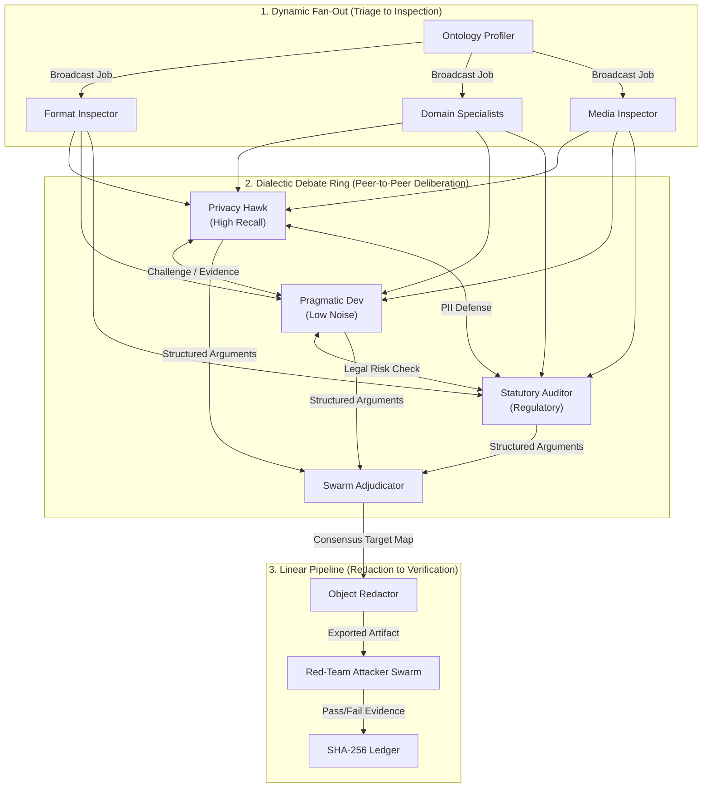

# 🌐 SHIELD·SCOUT Inter-Agent Connections & Communication Protocols

> **Communication Topology, Message Schemas & Deliberation Protocols**  
> *Defines how autonomous agents discover, exchange, debate, and verify data without leaking PII*

---

## 1. Inter-Agent Communication Topologies

SHIELD·SCOUT utilizes a **hybrid communication topology** tailored to the requirements of speed and adversarial rigor:



### Topologies Explained:
1. **Dynamic Fan-Out (Intake):** The Profiler acts as a router, broadcasting partitioned byte streams to specialized inspector agents in parallel threads.
2. **Dialectic Debate Ring (Resolution):** When entities fall into ambiguous score bands ($0.40 \le \text{score} < 0.75$), the agents enter a constrained peer-to-peer debate ring moderated by the `SwarmAdjudicator`.
3. **Linear Verification Pipeline (Sanitization):** Redaction and Red-Team verification operate strictly sequentially with zero debate: the Red Team either mathematically breaks the file or clears it.

---

## 2. Standard Message Envelope Schema

All inter-agent communication uses typed, validated JSON event envelopes conforming to the following specification:

```json
{
  "$schema": "https://json-schema.org/draft/2020-12/schema",
  "title": "AgentMessageEnvelope",
  "type": "object",
  "required": [
    "trace_id",
    "timestamp",
    "sender",
    "recipient",
    "dialogue_type",
    "payload"
  ],
  "properties": {
    "trace_id": {
      "type": "string",
      "description": "Unique session or run identifier (SHA-256 prefix)"
    },
    "timestamp": {
      "type": "string",
      "format": "date-time",
      "description": "ISO 8601 UTC timestamp ending in Z"
    },
    "sender": {
      "type": "string",
      "description": "ID of the sending agent (e.g., 'agent_privacy_hawk')"
    },
    "recipient": {
      "type": "string",
      "description": "ID of recipient agent, or 'broadcast', or 'adjudicator'"
    },
    "dialogue_type": {
      "type": "string",
      "enum": [
        "ENTITY_PROPOSAL",
        "CHALLENGE",
        "DEFENSE",
        "CONSENSUS_VERDICT",
        "ATTACK_PROBE",
        "ATTACK_RESULT"
      ]
    },
    "confidence": {
      "type": "number",
      "minimum": 0.0,
      "maximum": 1.0
    },
    "payload": {
      "type": "object",
      "description": "Contextual arguments, entity bounding boxes, or verification evidence"
    }
  }
}
```

---

## 3. Deliberation & Debate Protocols

To ensure agent deliberations do not degrade into endless conversational chatter or high latency, debates follow a **Strict Two-Round Protocol**:

```mermaid
sequenceDiagram
    autonumber
    participant H as Privacy Hawk
    participant D as Pragmatic Dev
    participant L as Statutory Auditor
    participant A as Swarm Adjudicator

    Note over H,A: Round 1: Discovery & Proposals
    H->>A: ENTITY_PROPOSAL (Type: IN_AADHAAR, Val: '2345 6789 0128', Score: 0.99)
    D->>A: ENTITY_PROPOSAL (Type: INVOICE_ID, Val: '2345 6789 0128', Score: 0.50)
    
    Note over H,A: Round 2: Cross-Examination & Evidence
    A->>D: CHALLENGE (H claims Aadhaar based on 12-digit formatting)
    D->>A: DEFENSE (Surrounding text has prefix 'INV-')
    A->>L: CHALLENGE (Validate statutory liability & checksum)
    L->>A: DEFENSE (Verhoeff checksum executed = VALID; statutory UIDAI liability)
    
    Note over H,A: Adjudication: Synthesis & Verdict
    A->>H: CONSENSUS_VERDICT (Aadhaar Confirmed: Redact with Black Box)
    A->>D: CONSENSUS_VERDICT (Invoice Overruled due to Verhoeff validity)
```

### Protocol Rules:
1. **Rule of Mathematical Superiority:** Cryptographic, algebraic, or checksum proofs (e.g., Verhoeff $D_5$ group validity, Luhn MOD-10 validity) instantly overrule heuristic or contextual arguments.
2. **Rule of Least Privilege (Zero-Trust):** If mathematical checksum is inconclusive and score remains above 0.60, the Privacy Hawk's argument prevails to prevent catastrophic exposure.
3. **Hard Cap:** A debate cannot exceed 2 turns. If no unanimous consensus is reached by Turn 2, the `SwarmAdjudicator` applies the conservative safety policy (Redact).

---

## 4. State & Memory Handoff Mechanisms

### 4.1 In-RAM Zero-Disk Handoff
* File bytes and image candidate arrays are passed between agents via **memory buffers (`bytes` and `np.ndarray`)** using Python references.
* No temporary disk writes occur during candidate evaluation.
* Once a media candidate is processed by the `Matcher`, its raw bytes are dereferenced and garbage collected (`del data, arr, img`).

### 4.2 Cryptographic Anchoring into the Ledger
* Inter-agent decisions are anchored directly into the SHA-256 ledger.
* When the `SwarmAdjudicator` resolves a verdict, an immutable block is appended:
  ```json
  {
    "seq": 4,
    "timestamp": "2026-10-30T13:30:00Z",
    "actor": "SwarmAdjudicator",
    "action": "CONSENSUS_REACHED",
    "details": {
      "debated_entity": "IN_AADHAAR",
      "consensus_score": 0.99,
      "unanimous": false,
      "winning_claim": "VerhoeffChecksumValid"
    },
    "prev_hash": "a4f8e7b..."
  }
  ```

---

## 5. Failure Handlers & Circuit Breakers

| Failure Scenario | Detecting Agent | Mitigation Protocol |
| :--- | :--- | :--- |
| **Agent Deadlock / Timeout** | `AgentFactory` | If any agent fails to reply within 5 seconds, it is terminated; the Adjudicator falls back to deterministic regex rules. |
| **Private IP SSRF Attempt** | `QueryFirewall` / `Fetcher` | Route abort triggered; domain added to `blocked` set; ledger logs `BLOCKED_MANUAL_CHECK`. |
| **Red-Team Attack Failure** | `RedTeamAttacker` | File is refused for export; pipeline re-triggers aggressive rasterization and deep stream purge. |
| **Tampered Ledger Chain** | `Ledger.verify()` | Immediate UI warning; identifies corrupted block sequence number; prevents Section 63 BSA dossier signing. |
